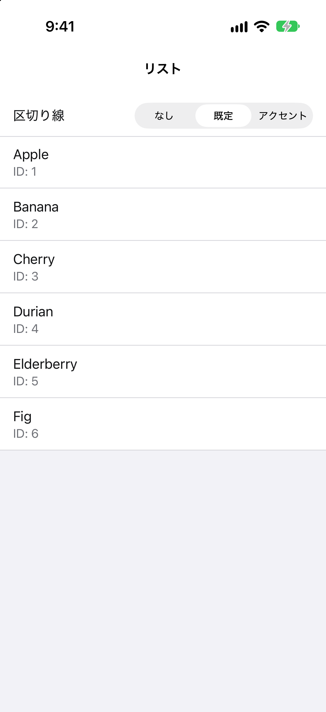
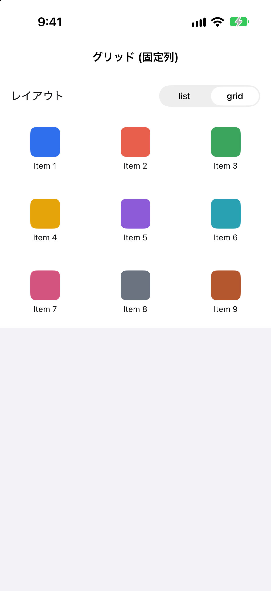
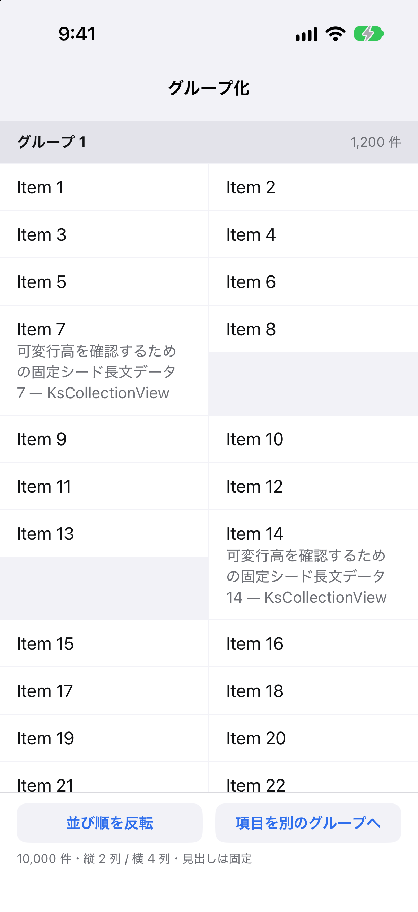
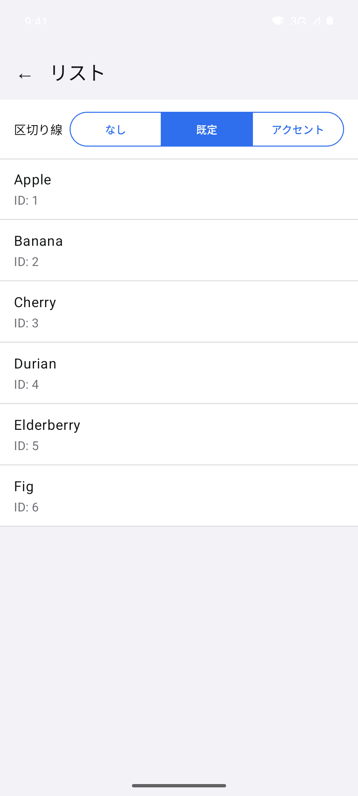
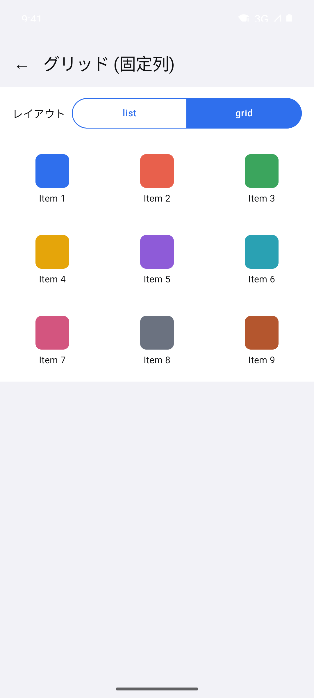
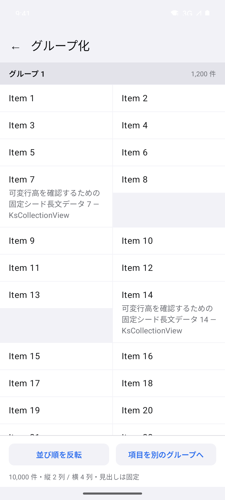

# KsCollectionView

[日本語](README_ja.md)

## Overview and key features

KsCollectionView is a list and grid library for SwiftUI on iOS and Jetpack Compose on Android. It offers the common building blocks of list screens, such as paging, pull to refresh, grouping, and drag-and-drop reordering, through matching APIs on both platforms.

- Lists and grids built from a plain array of items with stable IDs. Replacing the array animates the differences
- Grid columns given as a fixed count, as separate counts for portrait and landscape, or as a minimum item width
- Templates switched by item type, a header and a footer for the whole collection, separators, spacing, and content padding
- Grouping with group headers that stay pinned while scrolling
- Paging with loading, failure, end-of-list, and empty displays, plus pull to refresh
- Drag-and-drop reordering, including moves across groups and move actions for screen readers
- Image prefetching for the items about to appear, and an image component that shares the same cache
- Tap and long-tap callbacks with touch feedback, and programmatic scrolling

## Screenshots

The screens below are taken from the sample apps in this repository. The sample apps use Japanese for their own labels.

| | List | Grid | Grouping |
| --- | --- | --- | --- |
| **iOS** |  |  |  |
| **Android** |  |  |  |

## Supported platforms

| Platform | Minimum OS | What your build needs | What the library is built with |
| --- | --- | --- | --- |
| iOS | iOS 16 | Xcode 27 or later | Xcode 27.0 (Swift tools 6.4) |
| Android | Android 10 (API 29) | minSdk 29 or later, compileSdk 36 or later | Android Gradle Plugin 9.4.0, Kotlin 2.4.10, Gradle 9.7.0, Compose BOM 2026.06.01, JDK 21 (the published artifact targets Java 17) |

The "built with" column is the toolchain used to build the library, not the minimum for your project. On iOS, the package manifest declares Swift tools 6.4, so an older Xcode cannot resolve the package. On Android, the "your build needs" values come from the metadata of the published artifact and of the libraries it brings in. No minimum is stated for the Android Gradle Plugin or Kotlin: the library has been verified only with the versions in the "built with" column.

## Installation

The declarations write the version as the placeholder `{version}`. Replace it with the version you want to use; left as it is, dependency resolution fails. To find the latest version, see the [releases](https://github.com/kamusoft/KsCollectionView/releases) of this repository.

### iOS

Add the package and the product to your `Package.swift`. In an Xcode project, add the same package URL through Add Package Dependencies and choose the `KsCollectionView` product.

```swift
dependencies: [
    .package(url: "https://github.com/kamusoft/KsCollectionView-SPM", exact: "{version}"),
],
targets: [
    .target(
        name: "YourApp",
        dependencies: [
            .product(name: "KsCollectionView", package: "KsCollectionView-SPM"),
        ]
    ),
]
```

### Android

Add the dependency to the module that uses it. The artifact is distributed through Maven Central.

```kotlin
dependencies {
    implementation("jp.kamusoft:kscollectionview:{version}")
}
```

## Minimal code examples

Each example is a complete file that shows one list of 100 rows.

### iOS

```swift
import KsCollectionView
import SwiftUI

struct Item: Identifiable, Equatable, Sendable {
    let id: Int
    let title: String
}

struct ItemListScreen: View {
    private static let itemCount = 100

    private let items = (0..<itemCount).map { index in
        Item(id: index, title: "Item \(index)")
    }

    var body: some View {
        KsCollectionView(items) { item in
            Text(item.title)
                .frame(maxWidth: .infinity, alignment: .leading)
                .padding(.horizontal, 16)
                .padding(.vertical, 12)
        }
    }
}
```

### Android

```kotlin
import androidx.compose.foundation.layout.fillMaxSize
import androidx.compose.foundation.layout.fillMaxWidth
import androidx.compose.foundation.layout.padding
import androidx.compose.foundation.layout.safeDrawingPadding
import androidx.compose.foundation.text.BasicText
import androidx.compose.runtime.Composable
import androidx.compose.runtime.remember
import androidx.compose.ui.Modifier
import androidx.compose.ui.unit.dp
import jp.kamusoft.kscollectionview.KsCollectionView

data class Item(val id: Int, val title: String)

private const val ItemCount = 100

@Composable
fun ItemListScreen(modifier: Modifier = Modifier) {
    val items = remember { List(ItemCount) { index -> Item(id = index, title = "Item $index") } }
    KsCollectionView(
        items = items,
        key = { it.id },
        modifier = modifier.fillMaxSize().safeDrawingPadding(),
    ) {
        template { item ->
            BasicText(
                text = item.title,
                modifier = Modifier.fillMaxWidth().padding(horizontal = 16.dp, vertical = 12.dp),
            )
        }
    }
}
```

The example draws its text with `BasicText` from Compose Foundation so that it does not depend on Material. Your module needs Compose enabled and a dependency on Compose Foundation to compile it.

## Skills

Agent Skills hold the detailed usage guidance: what each feature does, working code for it, and the rules to follow. Copy the Skill for your platform into your project and let your coding agent read it.

- [iOS Skill](skills/en/kscollectionview-ios/SKILL.md)
- [Android Skill](skills/en/kscollectionview-android/SKILL.md)
- [Skills index](skills/README.md), with the installation steps and the Japanese editions

## Repository structure

| Directory | Purpose |
| --- | --- |
| `ios/` | iOS library and its Swift package |
| `android/` | Android library |
| `samples/` | Sample apps for iOS and Android |
| `skills/` | Agent Skills for users of the library, in English and Japanese |
| `verification/` | Minimal apps that build the library the way a user's project does |
| `scripts/` | Lint, verification, and distribution scripts |
| `assets/` | Images used by this README |
| `kasane/` | Development records: decisions, concepts, and change history |

## Contributing

Bug reports, proposals, and questions are welcome through GitHub Issues. Pull requests from external contributors are not accepted. See the [contribution guide](.github/CONTRIBUTING.md) for details.

## License

KsCollectionView is available under the [MIT License](LICENSE).

KsCollectionView directly depends on the following libraries. They are fetched as dependencies when you install it, together with the libraries they depend on, and each is distributed under its own license.

| Platform | Library | License |
| --- | --- | --- |
| iOS | Nuke | MIT License |
| Android | Jetpack Compose and other AndroidX libraries | Apache License 2.0 |
| Android | Coil | Apache License 2.0 |
| Android | Kotlin standard library | Apache License 2.0 |
